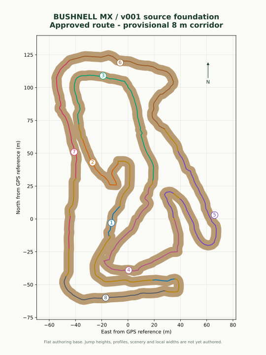

# Bushnell Motocross - v001

Bushnell is a separate MX Bikes project on branch **`bushnell-v001`**, entirely under **`BUSHNELL/`**.

The route is the user-approved layout v002: yellow connections applied, loop closed from video 8 to 1, and marked camera viewing detours excluded. The accepted geometry is locked by SHA-256 in `project.json`.



## Initial source milestone

- Approved closed route and eight ordered GoPro footage references.
- Independent 384 m authoring domain and 2049-node 16-bit heightmap source.
- **8 m provisional corridor width** for blockout; this is not a measured track width.
- Flat authoring terrain. Individual jump dimensions are still unmeasured and are listed in `source/obstacle_review.json`.
- Standard MX Bikes physics; independent Bushnell build and output names.
- Source foundation only: native compilation and a playable PKZ come later.

## Build and verify

```sh
python -m pip install -r BUSHNELL/requirements.txt
python -m unittest discover -s BUSHNELL/tests -v
python BUSHNELL/scripts/build_source.py
```

The workflow **Bushnell MX - v001 source foundation** runs only on `bushnell-v001` and uploads **BushnellMX-v001-source-and-previews**. Outputs stay in `BUSHNELL/build/v001/`. Original videos stay on Drive and outside Git.

## Next construction stage

Locate individual faces, lips, landings, rollers and berms on the approved route using the clip-by-clip queue. Author evidence-based or clearly identified estimated profiles, refine widths and scenery, and build the first native ride-test package.

Local validation: four geometry/coordinate regression tests passed and the full source build completed. See [source validation](docs/source_validation_v001.json).
