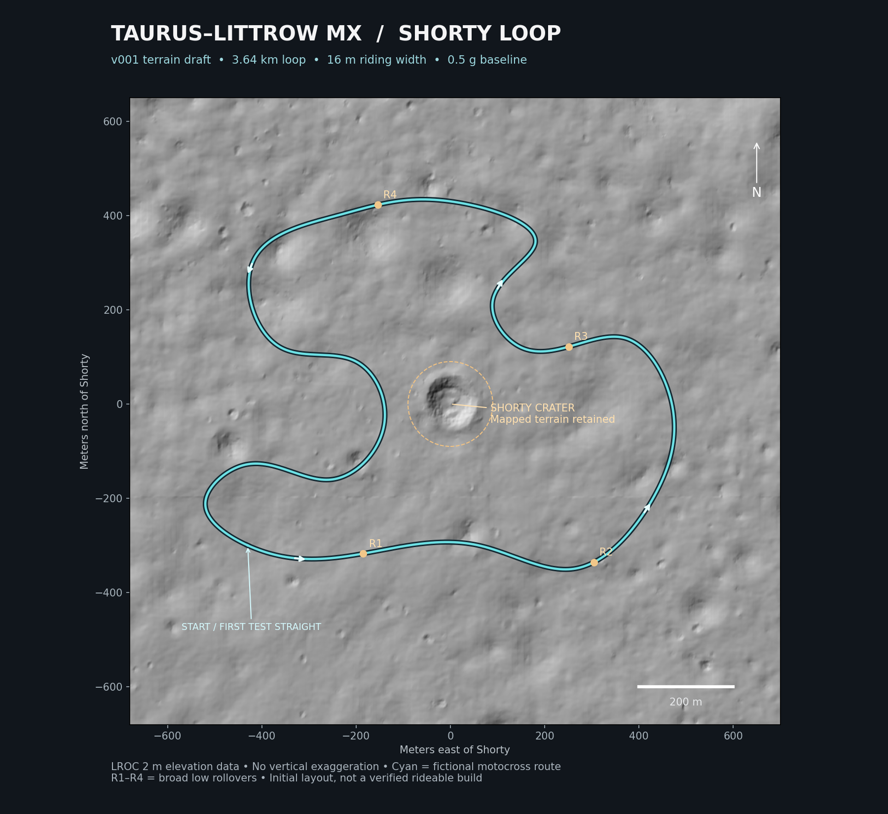

# Taurus–Littrow MX — Shorty Loop / v001

A Moon motocross source draft designed for **half Earth gravity (4.905 m/s²)**. Location: the Apollo 17 Taurus–Littrow valley around Shorty crater, approximately **20.217° N, 30.625° E**. The course is fictional motocross earthwork laid into measured lunar terrain.

**Status: terrain/layout blockout and offline Blender previews. Not an installable track or an in-game capture.** Photoreal material finishing, native compilation and riding validation are still ahead.



## This checkpoint

- 1,600 × 1,600 m riding terrain based on the LROC 2 m elevation model, with no vertical exaggeration.
- 3.64 km closed loop, 16 m riding width, four broad 1.15 m-high / 54 m-long rollers and mild outer berms. Approximately 24 m of route elevation change.
- Shorty crater retained as measured; no earthworks within 90 m of its reference point. Closest centerline point is approximately 140 m away.
- 24 km contextual valley, including the surrounding massifs, from LROC's wider DEM. Source products are blended outside the riding area to avoid seams.
- Reproducible 2049 × 2049 unsigned 16-bit heightmap, RAW, masks, provisional HMF/THT definitions, route CSV and gray regolith material inputs.
- Actual-geometry preview renders with a black sky, directional sunlight, illustrative microdetail and clasts.

The 0.78125 m output grid interpolates a 2 m measurement source; it is **not** a sub-meter lunar survey. Berms, rollers, grooming and individual scattered rocks are authored details. The current gray regolith is a procedural starting material, not a finished photographic scan.

## Gravity

The track itself does not set global gravity. Use the separately validated **MXB Quiet Gravity v4** with:

```ini
[gravity]
preset=half
```

This is a gameplay choice, not the Moon's physical 1.62 m/s² gravity. Only single-player Testing has been validated for the plugin. The track does not select the preset automatically. Multiplayer and replay behavior have not been established.

The low rollers avoid steep launch faces in this first prototype. Exact jump clearances, grip, suspension response and corner speed need an in-game test. Compact/soft soil are provisional game-material mappings; they do not implement real regolith mechanics or vacuum dust behavior.

## Reproduce

Python 3.12 and Blender 4.5.3 LTS were used. From the repository root:

```bash
python -m pip install -r MOON/requirements.txt
# Only needed when the source GeoTIFFs are missing:
python MOON/scripts/fetch_terrain.py
python MOON/scripts/build_source.py
blender -b --factory-startup -t 8 --python MOON/scripts/render_previews.py
```

Generated authoring files go to `MOON/build/`; previews go to `MOON/previews/`. `source/track_spec.json` records dimensions, validation results, gravity target and source hashes. `source/route_control_points.json` preserves the authored route. The HMF/THT and CSV are starting inputs, not a complete MX Bikes package.

## Data and fidelity

| Source | Use |
|---|---|
| [LROC NAC_DTM_APOLLO17_2M](https://data.lroc.im-ldi.com/lroc/view_rdr_product/NAC_DTM_APOLLO17_2M) | Riding-area measured heights, source spacing 2 m |
| [LROC NAC_DTM_APOLLO17](https://data.lroc.im-ldi.com/lroc/view_rdr_product/NAC_DTM_APOLLO17) | Wider 5 m DEM, sampled every fourth pixel for the 20 m context source |
| [USGS Shorty](https://planetarynames.wr.usgs.gov/Feature/5500) | Named feature and approximate modern reference position |
| [NASA: Apollo 17 at Shorty crater](https://science.nasa.gov/image-article/apod-2015-august-2-apollo-17-at-shorty-crater/) | Ground-level surface and lighting reference |

Elevation data credit: NASA/GSFC/Arizona State University, LRO/LROC team. Measurements use the Moon's 1,737,400 m reference sphere and the product's equirectangular projection, not terrestrial WGS84. Approximately 0.41% missing samples in the wider context crop are filled with nearest valid heights for scenery. The riding crop has no missing samples. No vertical exaggeration is applied.

## Next stage

Refine regolith, tire grooves, track edge readability and rock distribution; add start/pit/timing definitions and export contextual scenery; compile native MAP/TRH/EDF and package a separate Moon test track. Then tune with half gravity held fixed. Blender previews do not validate MX Bikes lighting, performance or rideability.

All Moon work is contained under `MOON/` on this branch. Orlando's published v067 remains unchanged on its own branch.
