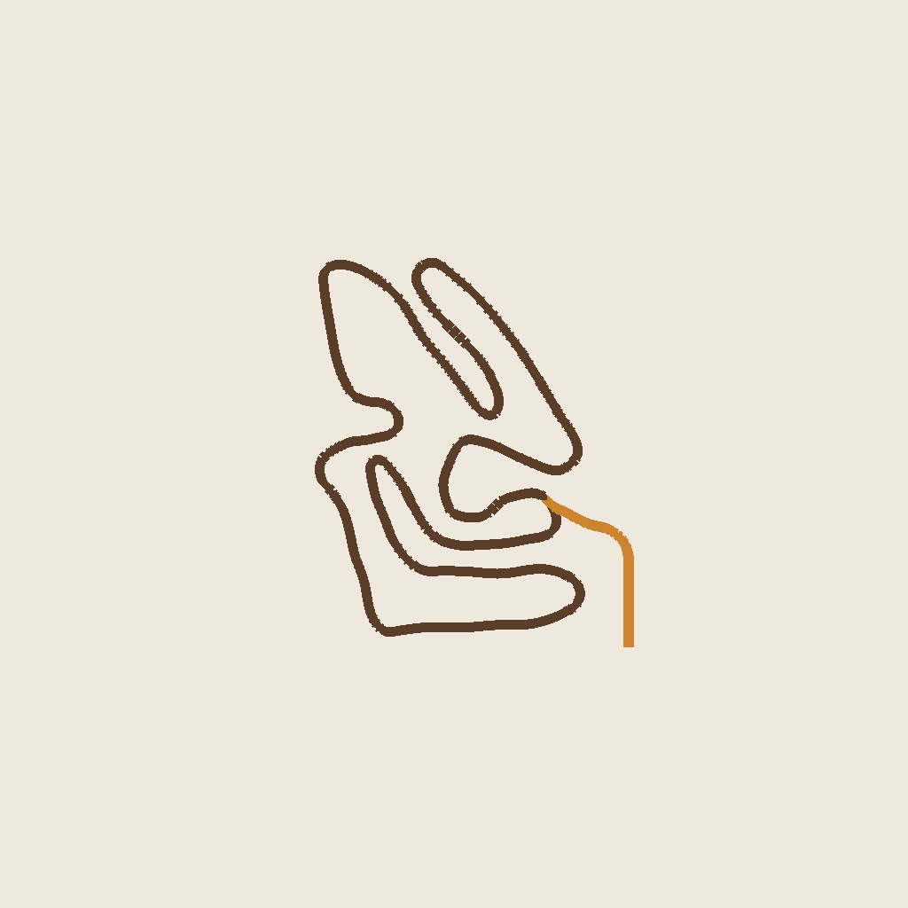
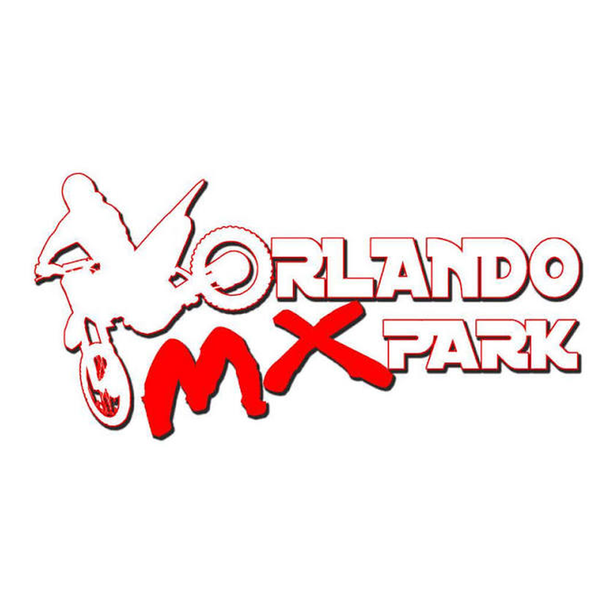

# Orlando MX v052 - aerial image for start-path markup

This is the exact track-info map image packaged in delivered v052, converted losslessly from TGA to PNG. No image pixels or track geometry have been changed. The existing map artwork may use an earlier aerial reference; it has not been newly rendered.

Draw your new starting path on this image. Use arrows to show direction and mark where it joins the main circuit. If you want to change the width, draw both edges.

## Track-info aerial

[Open or download the full-resolution aerial](OrlandoMX_v052_Track_Info_Aerial.png)

## Existing loading image

[Approved v052 package](https://github.com/mxsam72/orlando-mx-build/releases/download/v052-natural-dirt-grass-38537630164/OrlandoMX_2026_v052.pkz)

These images are for marking up the next start-path revision. v052 remains the approved baseline. v053's dirt changes were cancelled.
