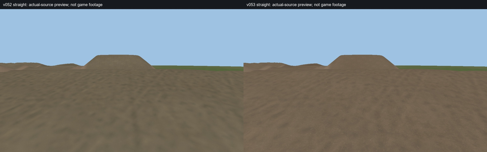
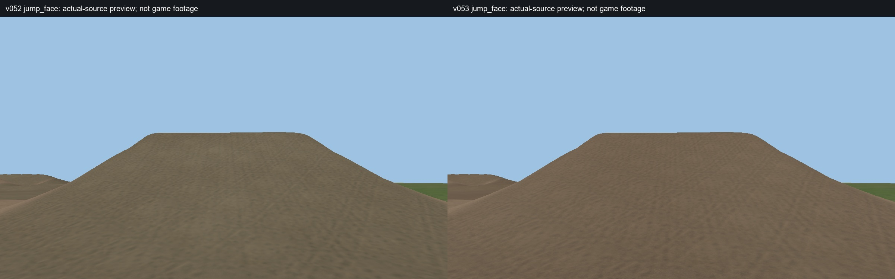
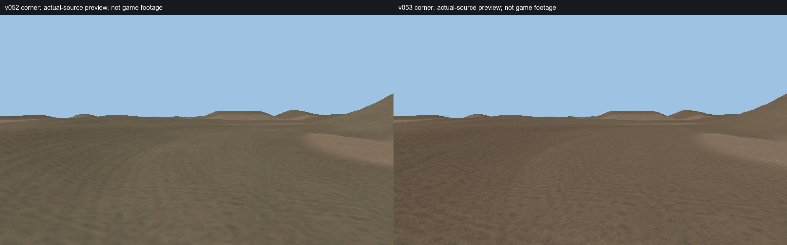
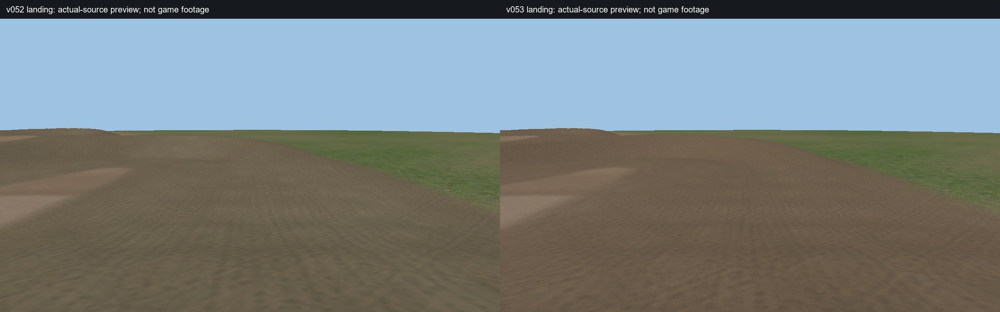

# v053 dirt comparison renders

**v052 is on the left; v053 is on the right.** Click an image to view it larger.

These are matched source previews of the terrain and dirt materials. Trees and other scenery are omitted in both views. They are not screenshots from MX Bikes. The track is compiling separately: [build status](https://github.com/mxsam72/orlando-mx-build/actions/runs/38581423680).

## Straight

[Open the v053 straight by itself](v053_straight.jpg)

## Jump face

[Open the v053 jump face by itself](v053_jump_face.jpg)

## Corner

[Open the v053 corner by itself](v053_corner.jpg)

## Landing

[Open the v053 landing by itself](v053_landing.jpg)
