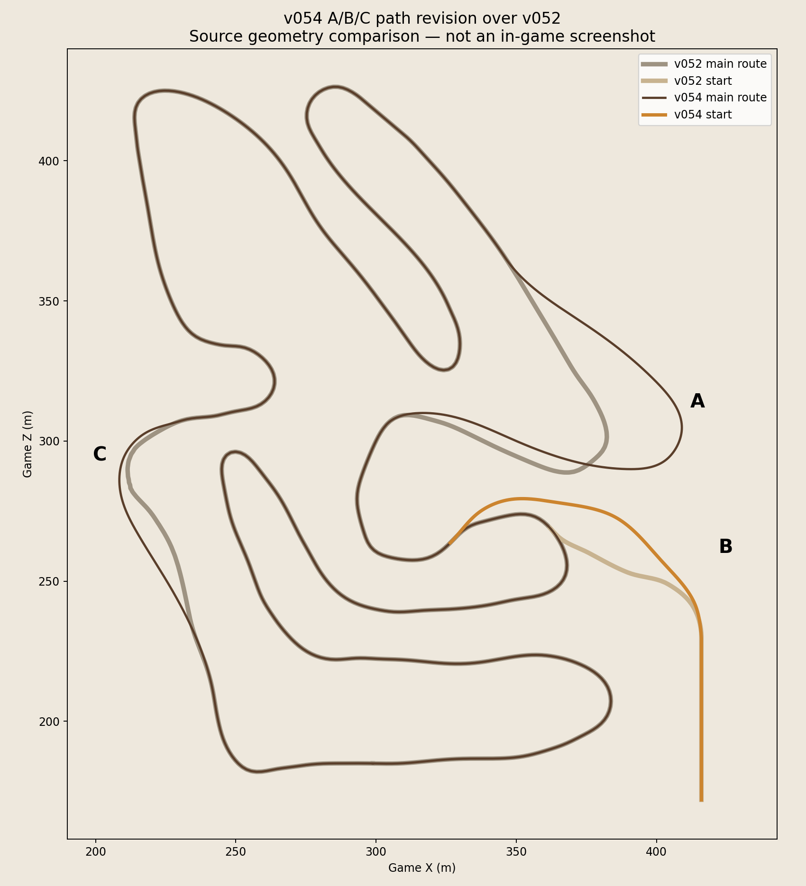
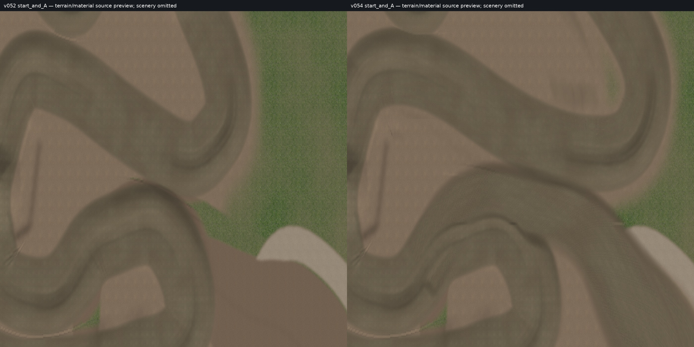
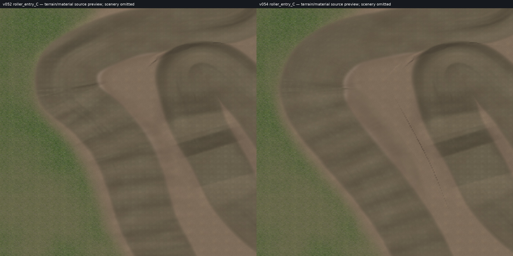
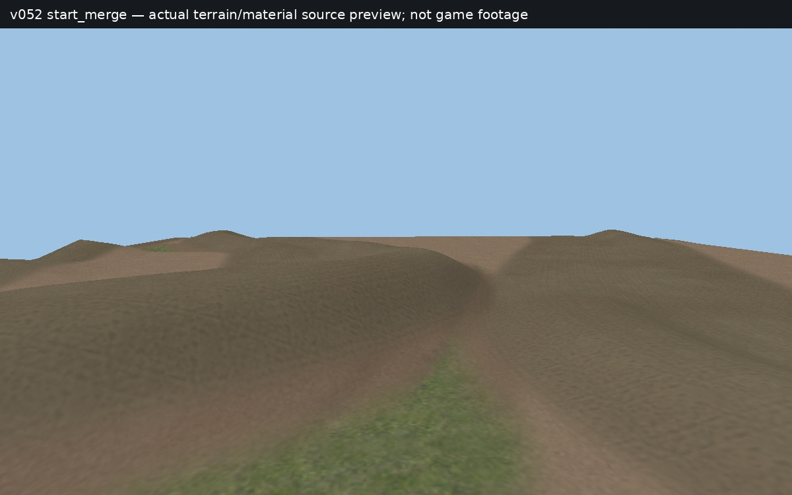
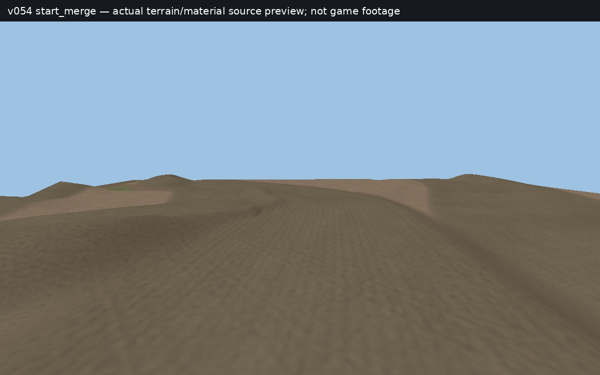

# v054 A/B/C starting-path revision

v052 is the approved baseline. The cancelled v053 dirt changes are not included. These are source geometry/material previews; scenery is omitted from the material views, and these are not MX Bikes screenshots.

## Paths

## Start and wider A corner — v052 left, v054 right

## Wider C entry to the eight rollers — v052 left, v054 right

## Entry height — matched source views

